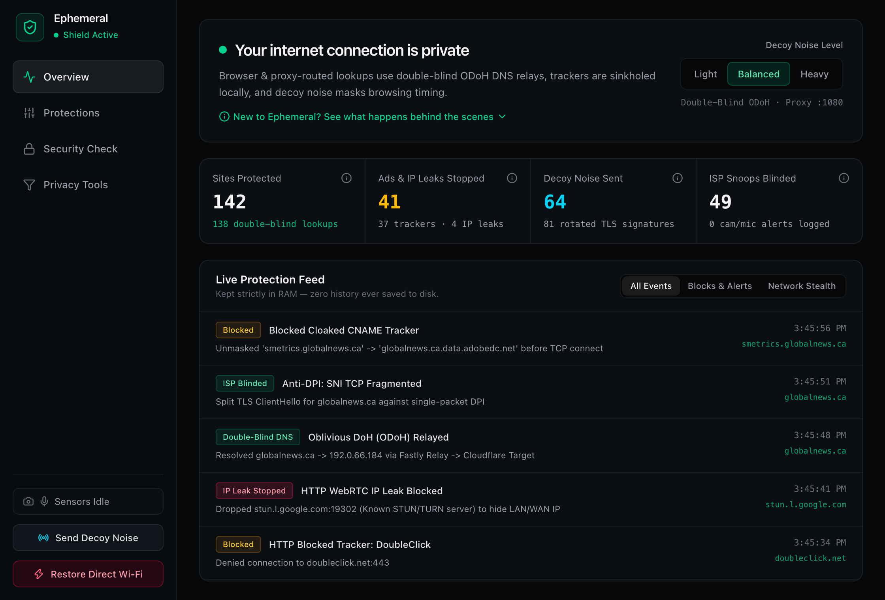
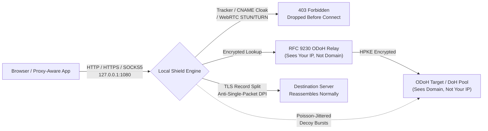
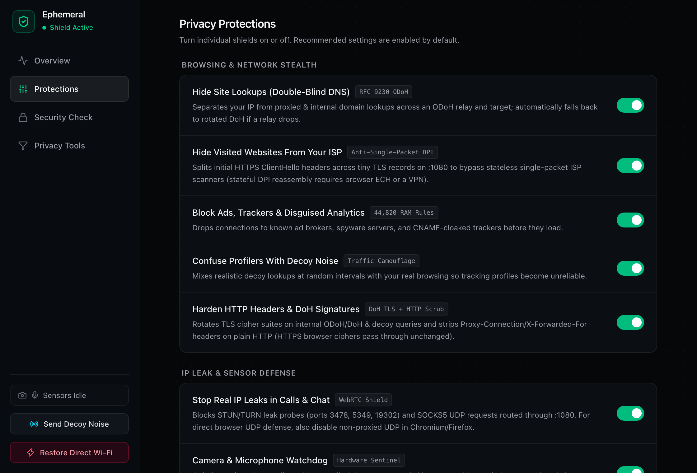
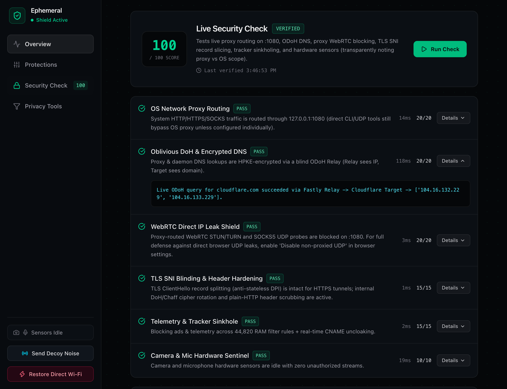

# Ephemeral Privacy Suite

Honestly, just trying to use the internet right now is exhausting. You open one page to check the weather and 40 ad trackers fire behind your back, analytics scripts hide under the site's own subdomain to dodge basic blockers, sites fingerprint your browser, and your ISP gets a neat little log of every domain you looked at. Everything feels like it's quietly watching you.

So I built **Ephemeral Privacy Suite** — a lightweight macOS privacy shield (Rust, Tauri v2, and Svelte 5) that runs locally on your Mac (`127.0.0.1:1080` + DNS `:5300`) and pushes back without logging anything to disk. It drops ads and sneaky CNAME trackers before they even connect, hides DNS lookups behind double-blind Oblivious DoH relays so no single server sees both your IP and the domain, splits up TLS handshakes so simple ISP sniffers can't read what you're opening, mixes in decoy traffic noise, keeps a silent eye on your mic and camera, and actually restores your Wi-Fi settings when you close it instead of killing your internet.



---

## How Traffic Flows (Without the Buzzword Soup)



---

## Inside the App

<details open>
<summary><strong>Privacy Protections &amp; Live Security Check (Screenshots)</strong></summary>

<br>

| Protections Toggles | Live Security Check |
|---|---|
|  |  |

</details>

---

## What It Actually Does

1. **Double-Blind DNS (RFC 9230 Oblivious DoH + DoH Failover)**
   - Uses `odoh-rs` HPKE encryption so the **relay** sees your IP but can't read the domain, and the **target** reads the domain without ever seeing your IP.
   - Automatically fails over across multiple ODoH routes and DoH upstreams (**Cloudflare, Quad9, Mullvad, LibreDNS**) when a resolver drops or complains.

2. **Tracker, Ad & CNAME-Cloaking Sinkhole (RAM-Only)**
   - Syncs community filter lists (Peter Lowe / HaGeZi) strictly into volatile memory alongside built-in ad-tech rules (zero disk logs or blocklist files written to disk).
   - Inspects DNS CNAME chains inside encrypted responses so first-party disguises like `smetrics.example.com -> metrics.adobedc.net` get `HTTP 403`'d before a TCP socket ever connects upstream.

3. **TLS SNI Record Splitting (Anti-Stateless DPI)**
   - Buffers initial `ClientHello` flights (up to 16 KB across multi-chunk writes) and splits them across multiple RFC-valid `0x16` TLS handshake records on `:1080` so lazy single-packet ISP DPI sniffers miss the SNI hostname — with zero MITM root certs.

4. **Traffic Camouflage & Signature Rotation**
   - Fires Poisson-jittered decoy DNS bursts (`Light` / `Balanced` / `Heavy`) across rotated resolvers while cycling `rustls` cipher suite orders and ALPN tokens on internal DoH/ODoH/chaff traffic.
   - Plain HTTP proxy requests have `Proxy-Connection`, `X-Forwarded-For`, and `Via` stripped, proxy-form URIs normalized, and `Connection: close` enforced so pipelined/keep-alive tracker requests can't sneak past policy checks.

5. **WebRTC Leak Shield (Proxy Layer)**
   - Rejects STUN/TURN endpoints (`3478`, `5349`, `19302–19309`, Google/Twilio/Xirsys/Metered relays) and SOCKS5 `UDP ASSOCIATE` attempts sent through `:1080`.

6. **Hardware Sensor Watchdog, Clipboard Sanitizer & AI PII Redactor**
   - **Camera & Mic Sentinel:** Silently polls macOS CoreAudio, CoreMediaIO, and Apple Silicon `ioreg` (`AppleH13`–`H16CamIn`) every 1.5s without triggering macOS permission prompts, lighting up an alert banner if something hot-mics you.
   - **Clipboard Link Cleaner:** Automatically strips `fbclid`, `gclid`, `utm_*`, `igsh`, `srsltid`, `mc_cid`, and friends from copied links without eating trailing sentence punctuation or leaving lonely `?`s behind.
   - **AI Chat PII Masker:** Swap emails, phone numbers, Luhn-checked cards, and API keys (`sk-ant-...`, `ghp_...`, `AKIA...`) with local placeholders (`[API_KEY_1]`) before pasting into web chats, then restore them locally.
   - **Menu Bar Companion & Panic Reset:** Hide-to-tray keeps shields running unobtrusively; clicking **Restore Direct Wi-Fi** (or quitting via `Cmd+Q` / Menu Bar / `SIGTERM`) resets macOS proxy settings back to direct internet.

---

## Honest Disclaimers (Stuff I Won't Pretend This Does)

I ran an adversarial red-team audit on my own app ([`BUG_REPORT.md`](BUG_REPORT.md)) — including catching an embarrassing bug where newly built DNS packets defaulted to `RD=0` (Recursion Desired = false) until fixed in `BUG-18` — because lying in security UI copy is worse than missing a feature.

Here is the unvarnished scope of running an unprivileged user-space proxy (without root, a kernel TUN driver, or installing a MITM root certificate):

- **Non-proxy CLI/UDP apps bypass `:1080`:** macOS routes Safari, Chrome, and proxy-aware apps through `127.0.0.1:1080`, while direct terminal UDP/raw sockets use macOS system DNS unless explicitly pointed at the proxy or `:5300`.
- **WebRTC needs browser backup:** The proxy blocks STUN/TURN and SOCKS5 UDP over `:1080`, but browsers can still send direct OS UDP ICE probes unless you also enable *"Disable non-proxied UDP"* in browser settings (or run a system VPN).
- **Browser HTTPS ciphers stay native:** Shuffling browser TLS ciphers mid-flight breaks TLS `Finished` verification unless an app MITMs every site with a custom root CA. Instead, I rotate TLS fingerprints on the app's own outbound DoH/ODoH/chaff traffic and scrub plain-HTTP headers, while leaving browser HTTPS keys end-to-end untouched.
- **SNI splitting targets single-packet DPI:** Stateful DPI boxes that reassemble multi-record TLS streams across TCP still see plaintext SNI unless the browser/server negotiates Encrypted Client Hello (ECH).

---

## Run, Test & Build

### Prerequisites
- [Rust](https://rustup.rs/) (1.80+)
- [Node.js](https://nodejs.org/) (20+)

### Commands
```bash
# Install frontend dependencies
npm install

# Run Rust unit tests (17 tests covering DNS/CNAME, DPI splits, HTTP scrub, PII, clipboard, watchdog)
cargo test --manifest-path src-tauri/Cargo.toml

# Run Svelte + TypeScript diagnostics
npm run check

# Run in desktop dev mode
npm run tauri dev

# Build the macOS release app bundle
npm run tauri build -- --bundles app
```
